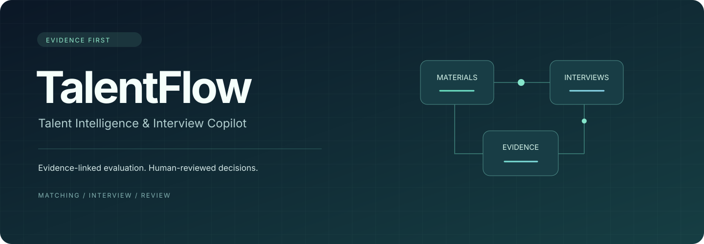
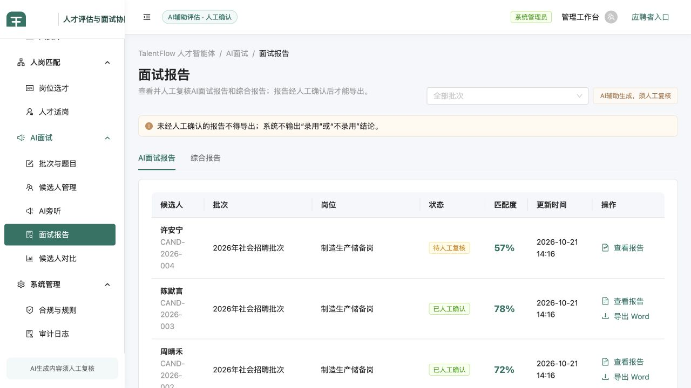
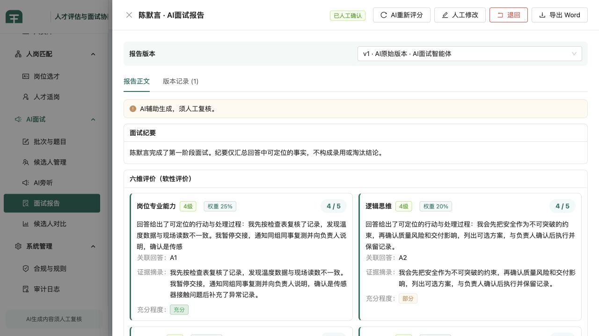
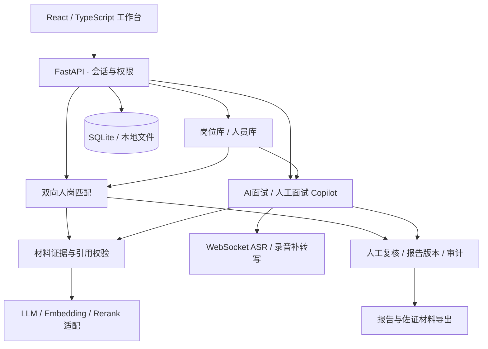

<p align="center">
  
</p>

<h1 align="center">TalentFlow</h1>
<p align="center"><strong>人才评估与面试协同平台</strong></p>
<p align="center">从人岗匹配到面试复盘，让每一条评估都有可回溯的依据。</p>
<p align="center">
  <a href="#功能概览">功能概览</a> ·
  <a href="#界面预览">界面预览</a> ·
  <a href="#快速开始">快速开始</a> ·
  <a href="docs/architecture.md">架构设计</a> ·
  <a href="docs/operations.md">配置指南</a>
</p>

---

TalentFlow 将 **双向人岗匹配、AI 结构化面试和人工面试 Copilot** 集成在同一个工作台中。岗位要求、候选材料、面试回答和报告版本在流程中相互关联，评估结果可以追溯到具体材料片段或回答记录。

项目面向招聘评估中的三个实际问题：资料分散、评估依据难以核对、面试与报告整理脱节。通过共享材料库、结构化分析、证据校验与人工复核，将“导入材料—评估—面试—复核—交付”串成完整流程。

**技术栈：** React 19 · TypeScript · Ant Design · FastAPI · SQLAlchemy · SQLite · WebSocket · LLM / Embedding / Rerank

## 功能概览

| 模块 | 主要能力 |
| --- | --- |
| **岗位库与人员库** | 维护岗位标准、批次和人员材料；解析简历，检查扫描页与缺失信息，复用已确认资料 |
| **岗位选才** | 面向一个岗位分析多位候选人，展示分维度评价、材料证据、对比结果与待核验事项 |
| **人才适岗** | 将候选材料与多个岗位逐项匹配，形成匹配矩阵，支持材料复用和结果复核 |
| **AI 结构化面试** | 审核发布题目，采集语音回答，进行受约束追问，生成带回答引用的面试报告 |
| **人工面试 Copilot** | 结合已有材料准备问题，辅助录音转写、发言角色更正、补充提问与综合报告整理 |
| **复核与交付** | 人工修改和确认、报告版本、角色权限、审计记录，以及 Word 报告与佐证材料包导出 |

## 界面预览

演示使用虚构候选人与本地模拟模型。

**面试报告工作台** — 按批次查看报告、复核状态和导出入口。



**证据驱动的报告** — 分维度展示评价、关联回答、证据摘录和充分程度，支持人工修改与版本回溯。



## 关键设计

### 评估结论与原始证据关联

文档解析后建立原文片段和位置索引，使用 Embedding 与 Rerank 辅助寻找相关材料。模型输出经过结构、证据编号和引用内容校验，再进入结果展示与复核流程。缺失材料、证据冲突和待核验事项保留在结果中，方便面试官继续核对。

### 人工复核贯穿业务流程

题目审核、材料确认、评估复核和报告确认分别建模。材料或岗位标准变化后，相关结果需要重新评估；关键导出入口检查权限和复核状态。人工修改记录原因与版本，原始分析和后续更正均可回看。

### 语音链路支持故障回退

WebSocket 接入流式 ASR，分段保存录音与时间信息。实时转写失败时保留音频，并尝试从已保存录音补转写。人工面试旁听支持上下文角色推断和人工更正，将后续分析连接到具体发言。

### 长任务与模型调用分层处理

模型适配层统一处理输出 Schema、超时、有限重试和失败原因。题目与报告生成通过后台任务执行；匹配任务以线程池和磁盘载荷管理，支持进程重启后恢复待处理任务。

## 系统架构

后端采用模块化单体：人岗匹配和面试保留各自的领域逻辑，共享岗位、人员、权限与审计能力。FastAPI 同时提供 API、WebSocket 和构建后的前端页面。



解析、评分、引用校验和任务恢复的代码入口见 [架构设计](docs/architecture.md)。

## 快速开始

环境要求：**Python 3.12、Node.js 22 和 npm**。

### 1. 获取代码与安装依赖

```bash
git clone https://github.com/Ringphone666/talentflow.git
cd talentflow

python -m venv .venv
source .venv/bin/activate
python -m pip install -r backend/requirements.txt

cd frontend
npm ci
npm run build
cd ..
```

Windows PowerShell 使用 `.venv\Scripts\Activate.ps1` 激活虚拟环境；也可直接调用 `.venv\Scripts\python.exe`。

### 2. 启动本地演示

```bash
python scripts/run_demo.py
```

打开 **<http://127.0.0.1:8000/>**。演示会在独立目录中初始化虚构候选人、题目和报告，使用模拟文本模型，可直接查看面试与复核流程。人岗匹配的真实 AI 评分、语音识别和 OCR 需要配置对应服务。

### 3. 使用自己的服务

停止演示后，复制配置示例并填写服务地址和密钥：

```bash
cp .env.example .env
python scripts/serve_api.py
```

正常模式使用独立的业务数据目录，首次启动为空业务库。模型网关的基础配置如下：

```dotenv
TALENTFLOW_MODEL_BASE_URL=https://your-model-gateway.example/v1
TALENTFLOW_LLM_API_KEY=your-api-key
MODEL_PROVIDER=external
TALENTFLOW_MATCH_KEY_ROTATED_CONFIRMED=true
```

默认逻辑模型别名为 `chat-primary`、`chat-evaluation`、`chat-reasoner`、`embedding-primary` 和 `rerank-primary`，需在自己的网关中映射。各模块的请求协议、语音服务与访问配置见 [运行指南](docs/operations.md)。

| 入口 | 地址 |
| --- | --- |
| 管理工作台 | `http://127.0.0.1:8000/` |
| 候选人入口 | `http://127.0.0.1:8000/interview` |
| API 文档 | `http://127.0.0.1:8000/docs` |

## 开发与验证

```bash
# 后端回归（在项目根目录）
python -m pytest backend/tests -o addopts='' -q

# 前端开发、测试与构建
cd frontend
npm run dev
npm test
npm run build

# 发布文件检查
cd ..
python scripts/check_release.py
```

最近一次本地验证：**617 项后端测试、320 项前端测试通过**，TypeScript 检查与生产构建通过。测试使用临时数据目录、模拟服务和合成文档，覆盖权限、材料解析、引用校验、匹配、面试及报告导出等路径。完整记录见 [验证说明](docs/verification.md)。

## 项目结构

```text
talentflow/
├── backend/
│   ├── app/
│   │   ├── core/             # 配置、数据库、会话、权限与后台任务
│   │   ├── library/          # 岗位库和人员库
│   │   ├── matching/         # 匹配 API 与证据下载
│   │   ├── interview/        # 面试、语音、旁听和报告
│   │   └── system/           # 入口、工作台与审计
│   ├── matching_core/        # 解析、遮蔽、检索、评分与导出
│   └── tests/                # 后端回归与合成资料
├── frontend/src/
│   ├── pages/                # 工作台、匹配、面试和候选人页面
│   ├── components/           # 共享界面组件
│   └── test/                 # 前端交互回归
├── scripts/                  # 启动、演示、测试资料生成和发布检查
├── docs/                     # 架构、配置、能力和验证文档
└── .github/workflows/        # 自动化检查
```

## 文档

- [架构设计](docs/architecture.md)：领域划分、证据链路、语音回退与任务恢复。
- [运行指南](docs/operations.md)：模型路由、可选服务、入口模式与数据目录。
- [能力与依赖](docs/capabilities.md)：已实现功能、模拟服务和预留接口。
- [验证说明](docs/verification.md)：检查结果、复现命令与验证范围。
- [贡献指南](CONTRIBUTING.md)：本地开发与提交约定。

## 实现范围

当前版本面向单实例运行，采用 SQLite、进程内执行器与本地文件存储；部分面试后台任务的运行状态仍在内存中。发言角色由上下文推断并可人工更正，外部人资系统的部分接口为预留适配。扩容、前端分包和外部服务效果评测是后续改进方向。

本仓库使用独立品牌和虚构演示资料。关于展示材料与许可的说明见 [版本说明](docs/release-scope.md)。
