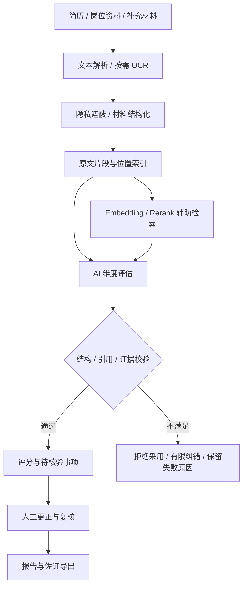

# TalentFlow 架构与关键设计

## 目标：让 AI 评估进入可复核的业务流程

纯粹调用模型生成报告，很难回答“结论来自哪里”“材料变化后是否需要重算”“谁确认了结果”。本项目围绕这些问题构建两个业务域：人岗匹配、面试协同。两者共享人员、岗位、会话权限与审计，但各自保留任务状态、证据和报告版本。

## 1. 模块化单体

`backend/app/main.py` 注册路由、初始化库表、恢复匹配任务，并可提供构建后的前端静态资源。业务路由按 `library`、`matching`、`interview`、`system` 划分；匹配领域的解析、评分、导出逻辑保存在 `matching_core/services`。

这是一套模块化单体，适合本机演示与单实例试点。代码没有微服务发现、Kubernetes 调度或跨节点事务，不把目录分层解释为分布式系统。

## 2. 证据驱动的人岗匹配

关键代码：

| 实现 | 代码入口 | 关注点 |
|---|---|---|
| 文本解析与导入 | `matching_core/services/parser.py`、`upload_detection.py` | 文字页与扫描页识别、异常输入处理 |
| 数据遮蔽 | `matching_core/services/privacy.py` | 联系方式、证件号等字段的遮蔽与请求检查 |
| 结构化模型适配 | `matching_core/services/model_adapter.py` | JSON 解析、长度限制、禁止重定向、超时与重试 |
| AI 结果校验 | `matching_core/services/candidate_scoring.py` | 证据编号、引用片段、维度、缺失证据与敏感信息 |
| 证据检索 | `matching_core/services/retrieval.py` | Embedding、Rerank 响应结构与数值检查 |
| 状态与复用 | `matching_core/services/workflow.py`、`talent_library.py` | 原材料复用、重新评分、失效状态、人工确认 |

这里的检索增强是围绕已提供材料进行相关证据排序，没有实现联网搜索、企业知识图谱或向量数据库集群。

## 3. 两阶段面试与旁听协同

第一阶段采用审核发布的主体题，追问以候选人的回答或简历证据为依据。第二阶段辅助人工面试，支持准备问题、录音转写、现场补充建议和综合报告。

`interview/listening_intelligence.py` 使用带来源字段的 Pydantic 模型表达问题和结论，并检查引用是否能在候选人发言或已有材料中定位。`listening_roles.py` 负责发言区间、角色推断和人工更正；上下文判断与声纹判断明确区分。

## 4. 语音采集与失败补救

`interview/speech_routes.py` 安装 WebSocket 语音路由；`doubao_asr.py` 实现流式协议、数据包解析及已保存音频转写。实时服务中断时保存录音并尝试补转写，避免把“已录音”等同于“已成功转写”。

强制对齐、OCR 和本地说话人服务为可选适配；公开版移除了原环境地址与路由编号，必须自行配置。离线演示不宣称具备真实语音识别效果。

## 5. 后台任务与状态恢复

匹配任务使用 `matching_core/services/task_queue.py` 的线程池与磁盘载荷；启动时由 `recover_pending_tasks()` 重新加载待处理任务。这支持单实例进程重启后的继续执行，不提供分布式 exactly-once 保证。

题目、旁听建议和综合报告由后台执行器处理，避免页面长时间等待。部分运行中状态位于内存；进程中断后需要重新发起，页面应说明中断原因。这一边界没有被包装成统一的持久化工作流引擎。

## 6. 信任边界

工作人员权限由本机入口或主系统授权会话决定。候选人仅能访问本人的面试资源；语音和导出路径进行会话及权限校验。模型输出作为候选分析，最终复核由人工执行。

隐私遮蔽是规则和业务流程提供的保护，不能保证覆盖所有自由文本中的个人信息。真实业务使用前仍须对输入、服务商和保存策略进行部署评估。

## 7. 后续可演进项

以下是演进方向，**不属于已实现成果**：将 SQLite 替换为 PostgreSQL；将进程内任务迁移至持久化队列；录音存储采用对象存储；模型路由治理与费用计量；基于匿名标注集的质量评测；前端按路由拆包。
